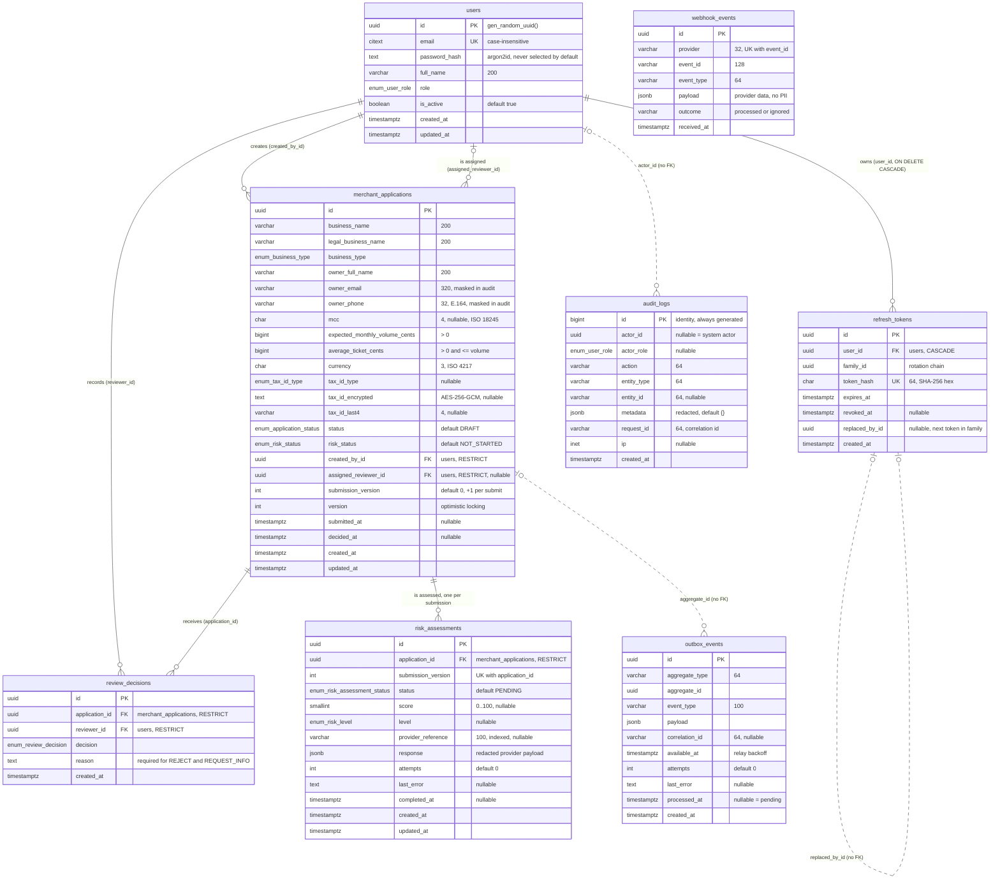
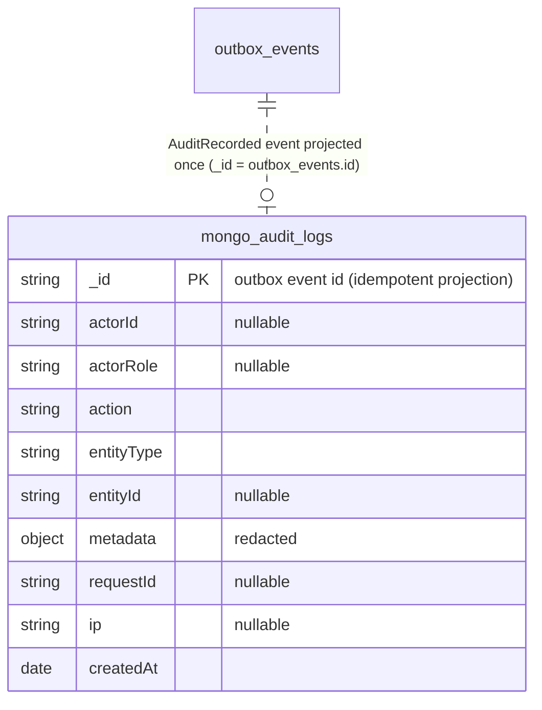

# Entity relationship diagram

PostgreSQL schema after all migrations (`src/core/database/migrations/`). Solid lines are foreign
keys; dotted lines are logical references deliberately **without** a foreign key (reasons below).
Types are Postgres types; `enum:` names a Postgres enum type listed further down.

## Relationships

| From                                         | To                         | Cardinality      | On delete | Meaning                                                               |
| -------------------------------------------- | -------------------------- | ---------------- | --------- | --------------------------------------------------------------------- |
| `merchant_applications.created_by_id`        | `users.id`                 | many to one      | RESTRICT  | the SALES (or ADMIN) user who owns the application                    |
| `merchant_applications.assigned_reviewer_id` | `users.id`                 | many to zero/one | RESTRICT  | the only REVIEWER allowed to decide                                   |
| `review_decisions.application_id`            | `merchant_applications.id` | many to one      | RESTRICT  | decision history (the application holds current status)               |
| `review_decisions.reviewer_id`               | `users.id`                 | many to one      | RESTRICT  | who decided                                                           |
| `risk_assessments.application_id`            | `merchant_applications.id` | many to one      | RESTRICT  | one row per submission, unique `(application_id, submission_version)` |
| `refresh_tokens.user_id`                     | `users.id`                 | many to one      | CASCADE   | sessions die with the user                                            |

Users and applications are never hard-deleted (RESTRICT everywhere they are referenced); users are
deactivated instead, which keeps decision and audit history intact.

### References without a foreign key (on purpose)

| Column                                | Points at                                  | Why no FK                                                                                        |
| ------------------------------------- | ------------------------------------------ | ------------------------------------------------------------------------------------------------ |
| `audit_logs.actor_id`                 | `users.id`                                 | audit history must outlive the rows it describes; NULL means a system actor (worker)             |
| `audit_logs.entity_id`                | any entity (by `entity_type`)              | polymorphic: applications, users, …                                                              |
| `outbox_events.aggregate_id`          | usually `merchant_applications.id`         | the outbox is generic infrastructure for any aggregate; events are processed, then kept as a log |
| `refresh_tokens.replaced_by_id`       | the next `refresh_tokens.id` in the family | informational link in the rotation chain; reuse detection works on `family_id`                   |
| `risk_assessments.provider_reference` | the KYB provider's id                      | external system; indexed for webhook lookups                                                     |

## Keys, constraints and indexes

| Table                   | Unique / check constraints                                                                                                                                                                                                | Indexes (besides PK and unique)                                                                                                        |
| ----------------------- | ------------------------------------------------------------------------------------------------------------------------------------------------------------------------------------------------------------------------- | -------------------------------------------------------------------------------------------------------------------------------------- |
| `users`                 | `uq_users_email` (citext)                                                                                                                                                                                                 |                                                                                                                                        |
| `merchant_applications` | `chk_…_volume_positive`, `chk_…_ticket_positive`, `chk_…_ticket_le_volume`, `chk_…_mcc_format` (`^[0-9]{4}$`), `chk_…_currency_format` (`^[A-Z]{3}$`), `chk_…_tax_id_complete` (all three tax id columns set or all null) | `(created_by_id, status, created_at)` SALES list · `(assigned_reviewer_id, status)` reviewer queue · `(status, created_at)` ADMIN list |
| `review_decisions`      |                                                                                                                                                                                                                           | `(application_id, created_at)`                                                                                                         |
| `risk_assessments`      | `uq_…_application_id_submission_version` (idempotency) · `chk_…_score_range` (0..100)                                                                                                                                     | `(provider_reference)` webhook lookup                                                                                                  |
| `refresh_tokens`        | `uq_refresh_tokens_token_hash`                                                                                                                                                                                            | `(user_id)` · `(family_id)` family revocation                                                                                          |
| `audit_logs`            | append-only: triggers block UPDATE, DELETE and TRUNCATE                                                                                                                                                                   | `(entity_type, entity_id, created_at)` · `(actor_id, created_at)`                                                                      |
| `outbox_events`         |                                                                                                                                                                                                                           | `(available_at) WHERE processed_at IS NULL` (partial, relay polling)                                                                   |
| `webhook_events`        | `uq_webhook_events_provider_event_id` (idempotency)                                                                                                                                                                       |                                                                                                                                        |

Leading index columns also cover the foreign key lookups on `merchant_applications`.

## Enum types

| Postgres type            | Values                                                             | Used by                                                 |
| ------------------------ | ------------------------------------------------------------------ | ------------------------------------------------------- |
| `user_role`              | ADMIN, REVIEWER, SALES                                             | `users.role`, `audit_logs.actor_role`                   |
| `business_type`          | SOLE_PROPRIETOR, PARTNERSHIP, LLC, CORPORATION, NON_PROFIT         | `merchant_applications.business_type`                   |
| `application_status`     | DRAFT, SUBMITTED, UNDER_REVIEW, INFO_REQUESTED, APPROVED, REJECTED | `merchant_applications.status`                          |
| `risk_status`            | NOT_STARTED, PENDING, COMPLETED, FAILED                            | `merchant_applications.risk_status` (latest submission) |
| `tax_id_type`            | PAN, VAT, EIN, GSTIN, OTHER                                        | `merchant_applications.tax_id_type`                     |
| `review_decision`        | APPROVE, REJECT, REQUEST_INFO                                      | `review_decisions.decision`                             |
| `risk_assessment_status` | PENDING, COMPLETED, FAILED, AWAITING_CALLBACK                      | `risk_assessments.status`                               |
| `risk_level`             | LOW, MEDIUM, HIGH                                                  | `risk_assessments.level`                                |

## Optional MongoDB audit store

With `AUDIT_STORE=mongo`, audit entries are projected from `outbox_events` (event type
`AuditRecorded`) into a MongoDB collection instead of the Postgres `audit_logs` table.

Indexes `{ entityType, entityId, createdAt: -1 }`, `{ actorId, createdAt: -1 }`,
`{ action, createdAt: -1 }`, created by `infra/mongo/init/01-audit.js`. The application user may
only `find` and `insert` (server runs with `--auth`).
