# Sequence diagrams

How each HTTP endpoint and each worker component uses the services in the codebase. Names match
the classes and methods in `src/`. Shaded boxes are database transactions; everything inside one
box commits or rolls back together.

Contents

1. [Shared HTTP request pipeline](#1-shared-http-request-pipeline)
2. [POST /auth/login](#2-post-authlogin)
3. [POST /auth/refresh and /auth/logout](#3-post-authrefresh-and-authlogout)
   - [POST /users, GET /users and PATCH /users/:id](#post-users-get-users-and-patch-usersid)
4. [POST /applications (create)](#4-post-applications-create)
5. [GET /applications and GET /applications/:id](#5-get-applications-and-get-applicationsid)
6. [PATCH /applications/:id](#6-patch-applicationsid)
7. [POST /applications/:id/assign](#7-post-applicationsidassign)
8. [POST /applications/:id/submit](#8-post-applicationsidsubmit)
9. [Worker: outbox relay](#9-worker-outbox-relay)
10. [Worker: risk review job (sync KYB)](#10-worker-risk-review-job-sync-kyb)
11. [Worker: retries exhausted, dead letter, ADMIN retry](#11-worker-retries-exhausted-dead-letter-admin-retry)
12. [Worker: reaper](#12-worker-reaper)
13. [POST /applications/:id/decision](#13-post-applicationsiddecision)
14. [Callback mode: POST /webhooks/kyb](#14-callback-mode-post-webhookskyb)
15. [Audit: write path per store, GET /audit, GET /audit/stats/decisions](#15-audit-write-path-per-store-get-audit-get-auditstatsdecisions)
16. [End to end: from submit to decision](#16-end-to-end-from-submit-to-decision)

Process map

| Process            | Entry point      | Runs                                                                                  |
| ------------------ | ---------------- | ------------------------------------------------------------------------------------- |
| API                | `dist/main.js`   | controllers, guards, services; writes outbox events; receives KYB webhooks            |
| Worker             | `dist/worker.js` | `OutboxRelay` (every 1 s), `RiskReviewProcessor` (BullMQ), `RiskReviewReaper` (5 min) |
| PostgreSQL         |                  | all business data, `outbox_events`, `audit_logs` (default store), `webhook_events`    |
| Redis              |                  | BullMQ queues `risk-review` and `risk-review-dlq`                                     |
| MongoDB (optional) |                  | `audit_logs` collection when `AUDIT_STORE=mongo`                                      |

---

## 1. Shared HTTP request pipeline

Every request below goes through these steps first. Later diagrams start at the controller.

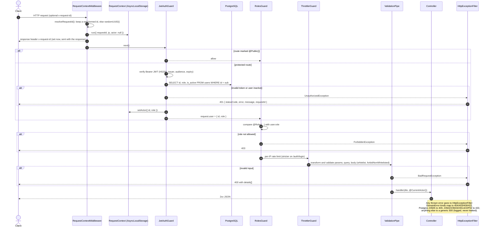

---

## 2. POST /auth/login

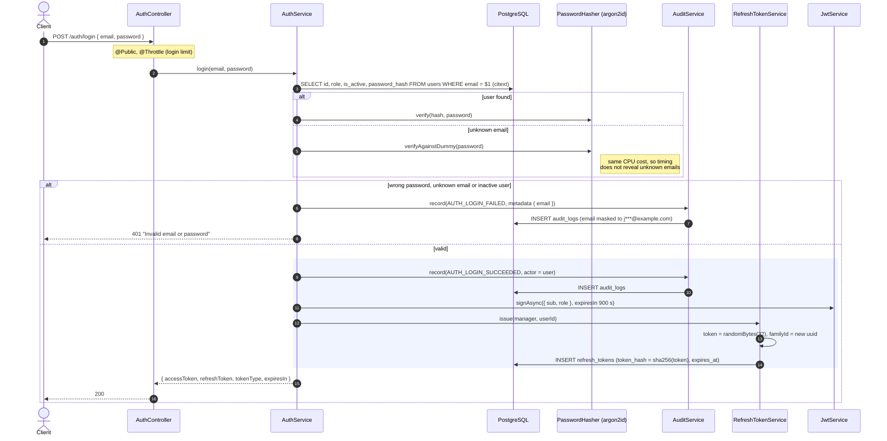

---

## 3. POST /auth/refresh and /auth/logout

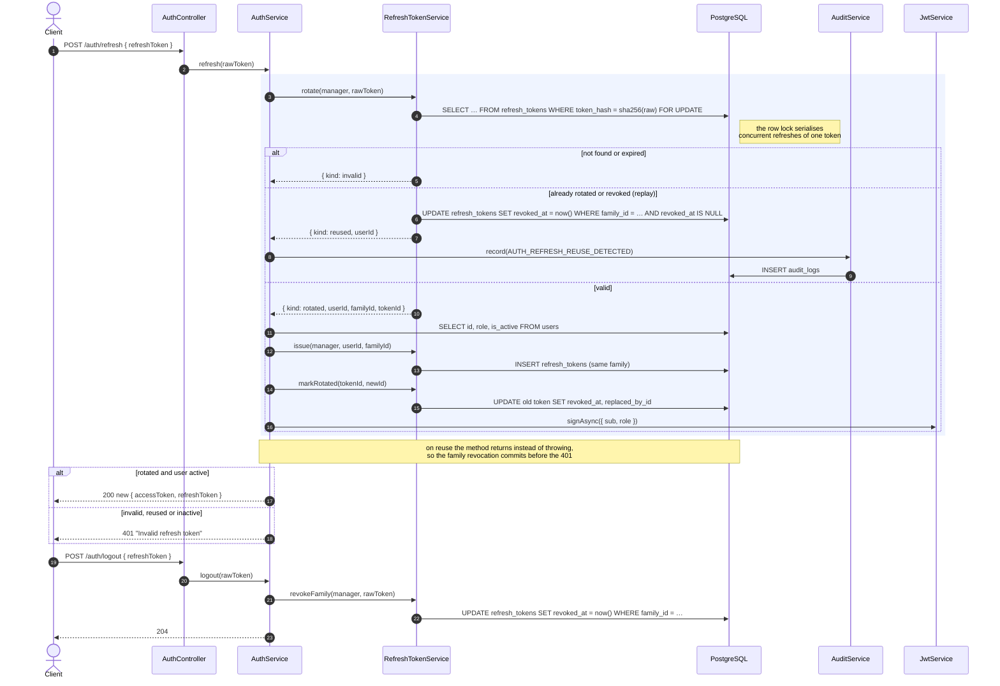

### POST /users, GET /users and PATCH /users/:id

ADMIN-only account management. ADMIN accounts themselves are not creatable through the API.

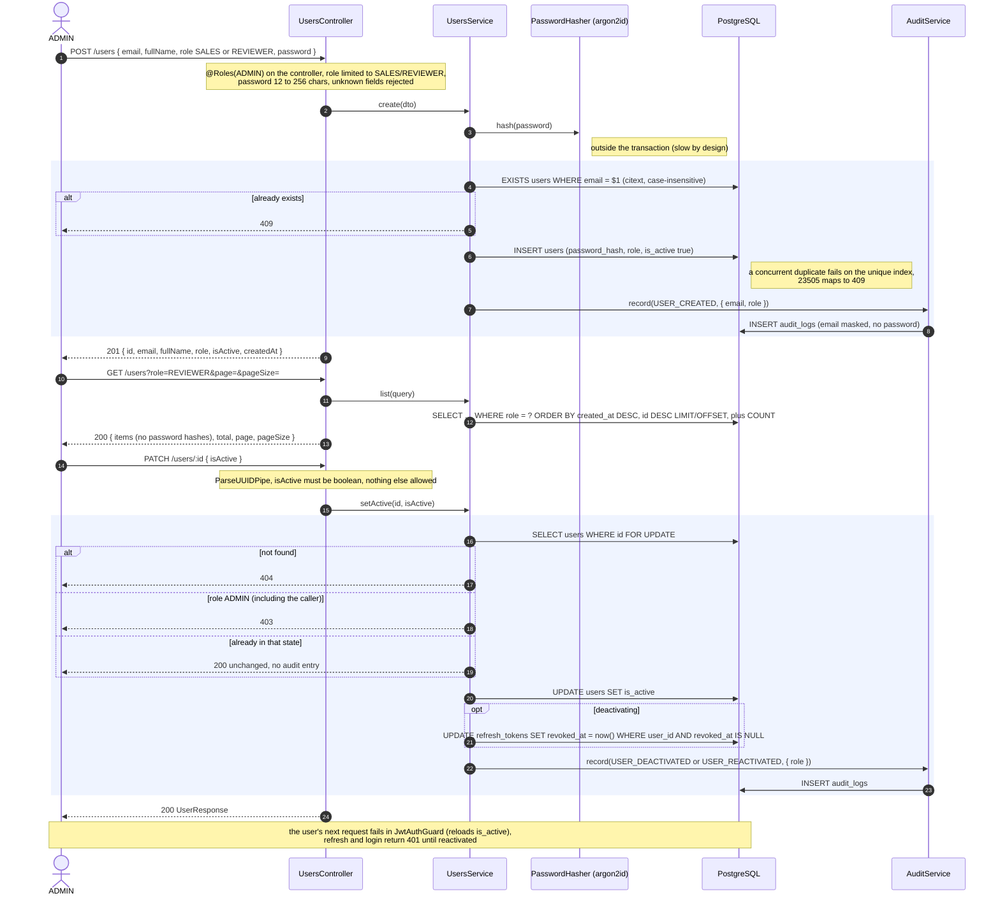

---

## 4. POST /applications (create)

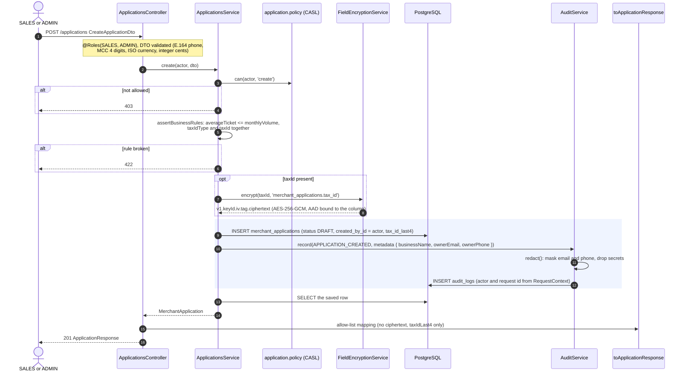

---

## 5. GET /applications and GET /applications/:id

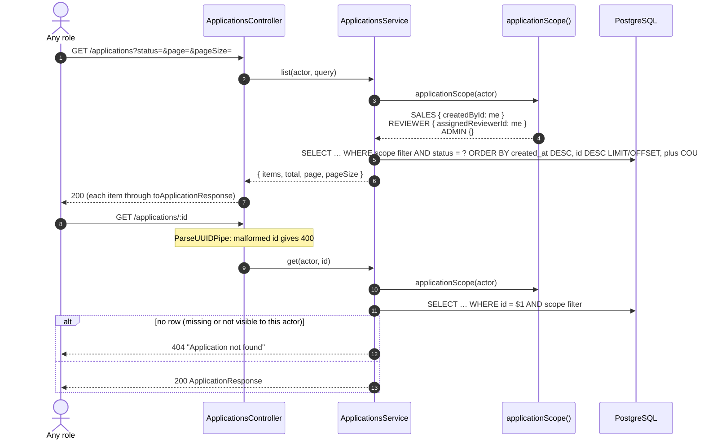

---

## 6. PATCH /applications/:id

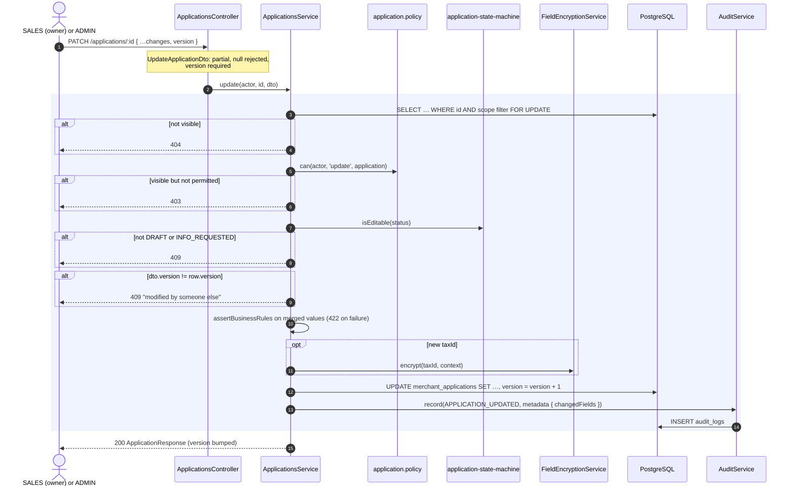

---

## 7. POST /applications/:id/assign

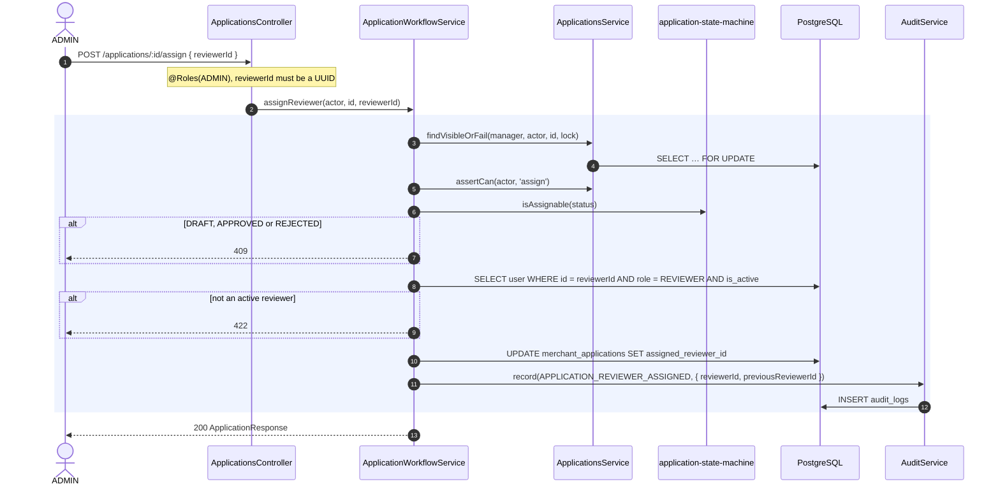

---

## 8. POST /applications/:id/submit

The API never talks to Redis here: the job is recorded in Postgres, in the same transaction as the
status change, and the worker publishes it (diagram 9).

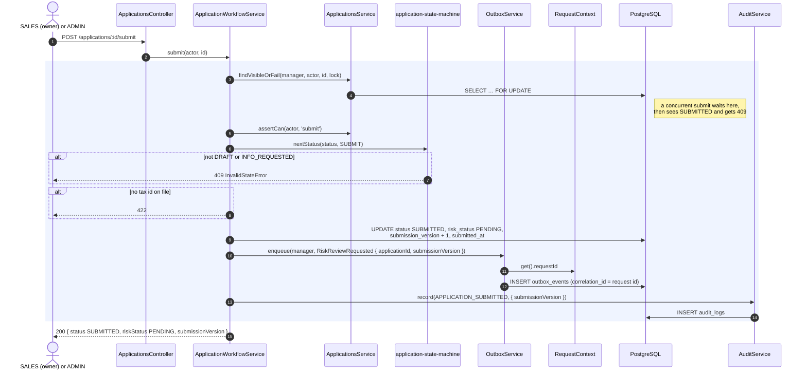

---

## 9. Worker: outbox relay

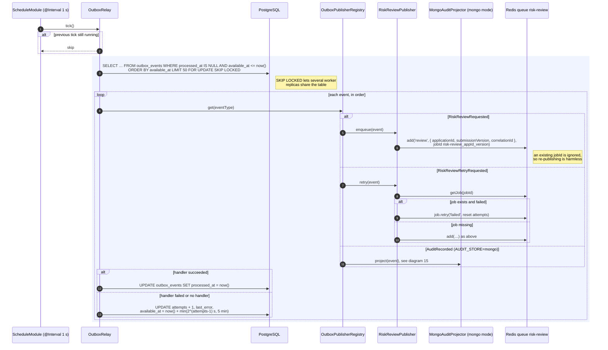

---

## 10. Worker: risk review job (sync KYB)

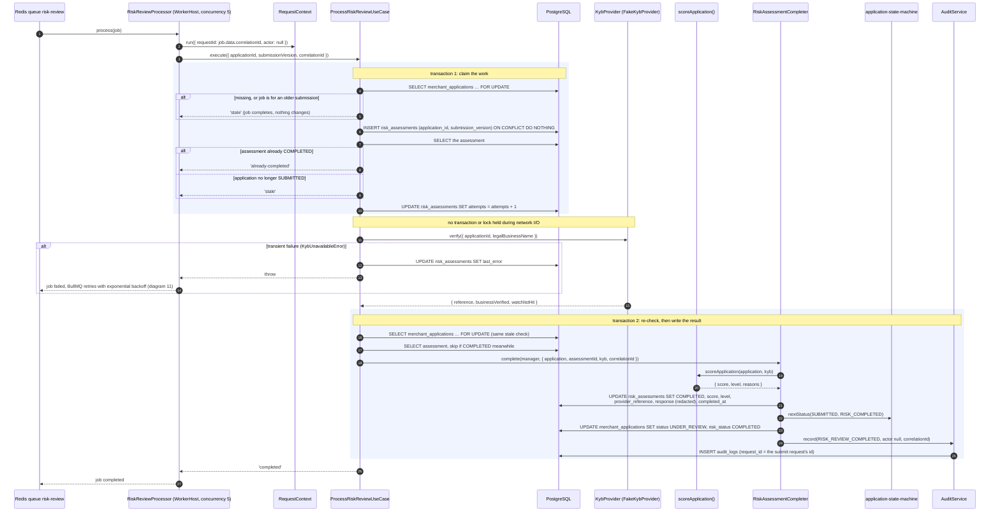

---

## 11. Worker: retries exhausted, dead letter, ADMIN retry

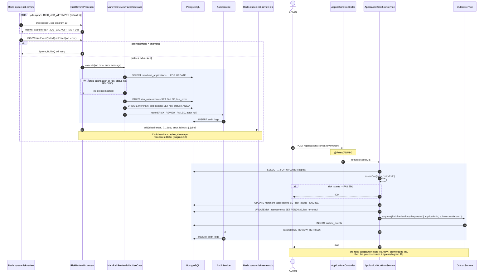

---

## 12. Worker: reaper

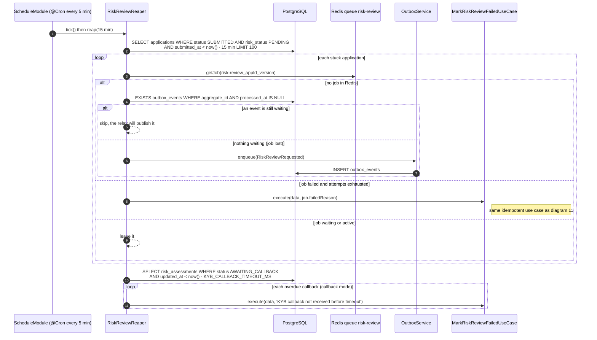

---

## 13. POST /applications/:id/decision

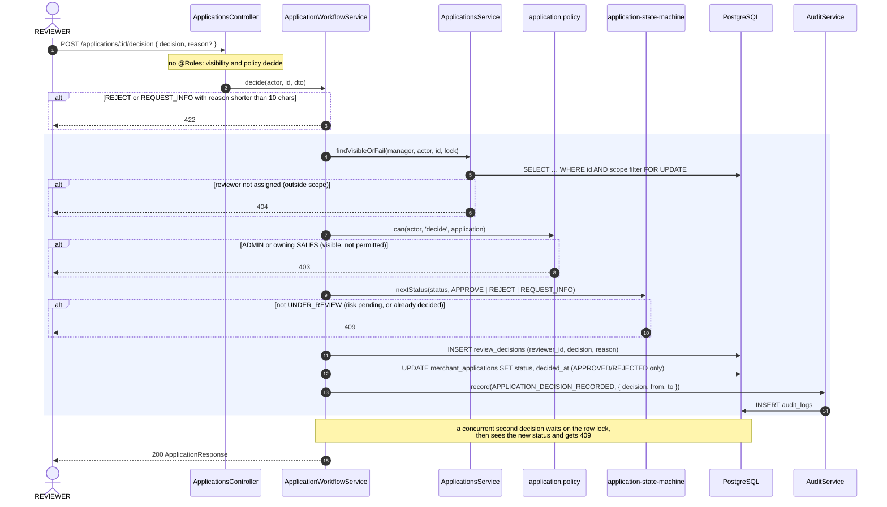

---

## 14. Callback mode: POST /webhooks/kyb

With `KYB_MODE=callback` the worker only requests verification. The provider (here the simulated
`FakeKybProvider`) later calls the API.

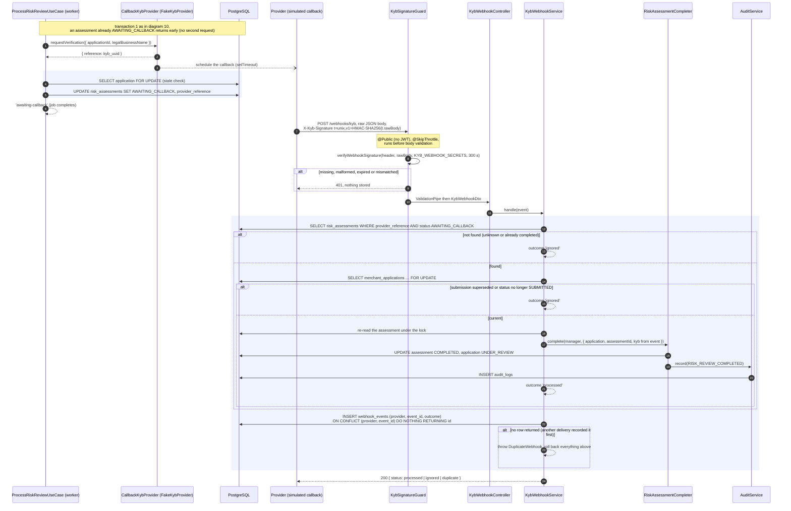

---

## 15. Audit: write path per store, GET /audit, GET /audit/stats/decisions

`AuditService` is the only entry point for writing; the configured adapter decides where the entry
goes. `AUDIT_STORE` is read when modules are defined.

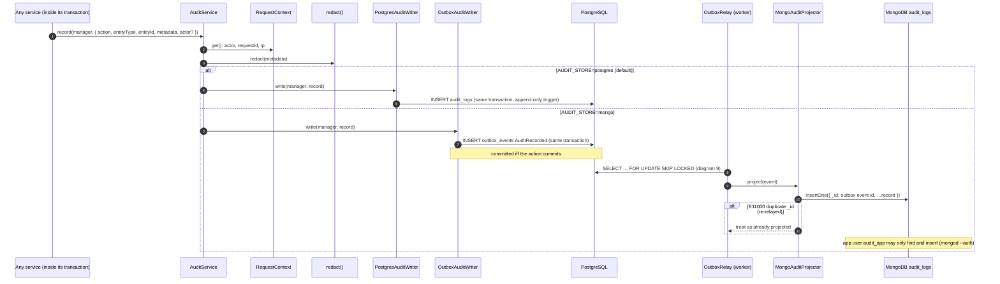

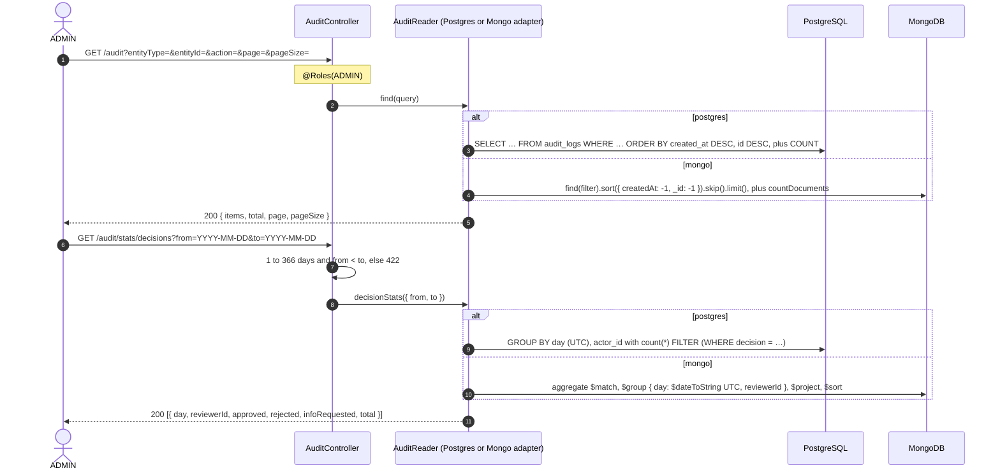

---

## 16. End to end: from submit to decision

The whole happy path across both processes, condensed.

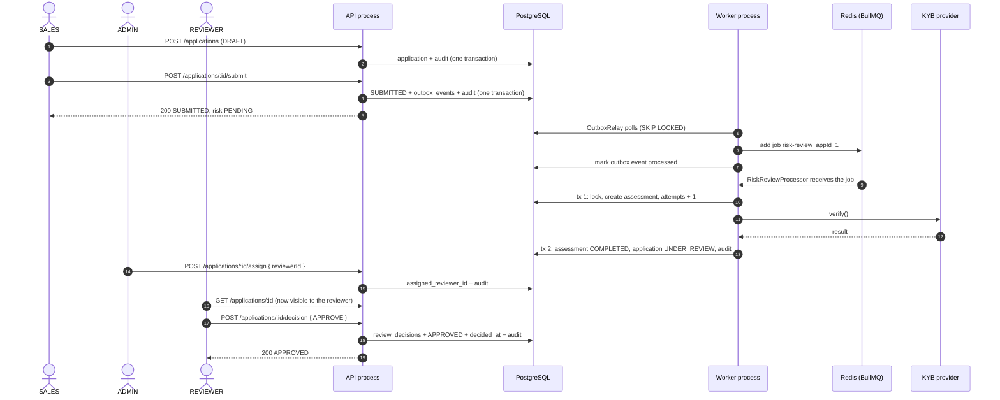
